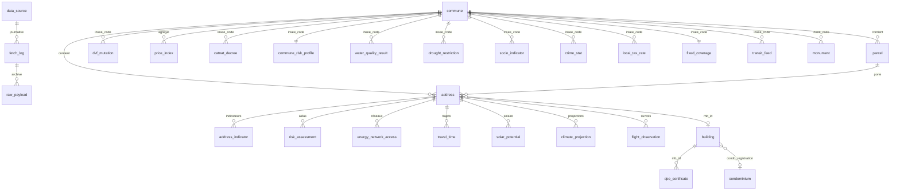

# HomePedia : schéma MariaDB

> Source de vérité : [`backend/src/database/sql/001_initial_schema.sql`](../backend/src/database/sql/001_initial_schema.sql),
> exécuté par la migration TypeORM `InitialSchema1759363200000`. 44 tables, MariaDB ≥ 10.6 (testé sur 11.4).

## 1. Principes

| Principe | Mise en œuvre |
|---|---|
| **Entité pivot** | `address` : point BAN géolocalisé, rattaché à une `commune` (code INSEE), à une `parcel` (IDU cadastral) et à un bâtiment RNB (`rnb_id`). Toutes les données « à l'adresse » référencent `address.id` (suppression en cascade). |
| **Trois niveaux de rattachement** | *Adresse* (`risk_assessment`, `travel_time`, `solar_potential`...) ; *commune* (`catnat_decree`, `water_quality_result`, `socio_indicator`...) ; *objet géographique autonome* avec sa propre géométrie (`nuisance_poi`, `school`, `risk_site`, `mobile_site`...), interrogé par rayon autour de l'adresse. Un même objet sert donc à plusieurs adresses sans duplication. |
| **Traçabilité et fraîcheur** | Chaque table métier porte `source_code` (FK `data_source`), `fetched_at` et `expires_at`. Le TTL par défaut est défini par source dans `data_source.ttl_seconds` (de 15 min pour OpenSky à 1 an pour les projections climatiques). |
| **Cache** | Chaque collecte « source × cible » est journalisée dans `fetch_log`. Si une collecte réussie non expirée existe pour la même cible, l'API externe n'est pas rappelée (`status: cached`). `?force=true` contourne le cache. |
| **Réponses brutes** | `raw_payload` archive le JSON brut d'une collecte (désactivable via `STORE_RAW_PAYLOADS`), pour rejouer une normalisation sans rappeler l'API. |
| **Géospatial** | WGS84 (SRID 4326), WKT en ordre « lon lat ». Colonnes `POINT` / `GEOMETRY` `NOT NULL` + `SPATIAL INDEX` (R-tree). Les `latitude` / `longitude` sont aussi stockées en `DECIMAL(9,6)` pour l'export et le tri. |
| **Idempotence** | Chaque table a une clé naturelle unique (IDU, n° DPE, code BSS, SIRET...). Les collectes font des `INSERT … ON DUPLICATE KEY UPDATE` : rejouer une collecte ne crée pas de doublon. DVF, sans identifiant de ligne, est dédoublonné par un hachage SHA-1 du contenu (`row_hash`). |
| **Données semi-structurées** | Colonnes `LONGTEXT CHECK (JSON_VALID(...))` (équivalent MariaDB du type JSON) pour les listes et détails variables : usages sécheresse, tags OSM, détails ICPE. |

## 2. Modèle (vue d'ensemble)



Les objets géographiques autonomes (`plu_zone`, `plu_prescription`, `public_easement`, `risk_site`, `groundwater_station`, `nuisance_poi`, `nuisance_line`, `service_place`, `school`, `charging_station`, `parking_facility`, `transit_stop`, `mobile_site`) ne portent pas de clé étrangère vers `address` : ils sont reliés à une adresse **par requête spatiale**.

Seules `address`, `parcel` et les tables « à l'adresse » ont des clés étrangères physiques (avec `ON DELETE CASCADE` depuis `address`). Les tables communales n'en ont pas vers `commune` : elles peuvent être alimentées par des imports nationaux (ARCEP, SSMSI) avant que la commune soit chargée.

## 3. Tables par domaine

### Socle

| Table | Clé | Contenu | Index notables |
|---|---|---|---|
| `data_source` | `code` | Registre des ~45 sources : URL, domaine, TTL, clé requise, statut (`verified`, `degraded`, `obsolete`, `untested`) | — |
| `fetch_log` | `id` | Une ligne par collecte : statut, durée, nb d'éléments, code HTTP, erreur, `expires_at` | `(source_code, target_key, status, fetched_at)` : recherche de cache |
| `raw_payload` | `id` | JSON brut d'une collecte (≤ 4 Mo) | `(source_code, target_key)` |

### Géo et urbanisme

| Table | Clé | Source | Index |
|---|---|---|---|
| `commune` | `insee_code` | API Géo | département, région, EPCI, **spatial** `center` |
| `parcel` | `idu` | API Carto cadastre | INSEE, **spatial** `geom` |
| `address` | `id` (unique `ban_id`) | BAN | INSEE, parcelle, RNB, **spatial** `location` |
| `address_indicator` | `id` (unique adresse+domaine+indicateur) | calculs (climat, mobilité, services) | `(domain, indicator)` |
| `plu_zone` | `id` (unique `gpu_id`) | GPU `zone-urba` | `(insee, zone_type)`, **spatial** |
| `plu_prescription` | `id` (unique `gpu_id`) | GPU `prescription-surf/lin/pct` | `(insee, type_code)`, **spatial** |
| `public_easement` | `id` (unique `gpu_id`) | GPU `assiette-sup-s` (AC1 = abords MH) | `sup_type`, **spatial** |
| `monument` | `reference` (PA…) | Liste des immeubles MH | INSEE |

### Bâtiment et marché

| Table | Clé | Source | Index |
|---|---|---|---|
| `building` | `rnb_id` | RNB + enrichissement BDNB | BDNB, `(insee, construction_year)`, copro, **spatial** |
| `dpe_certificate` | `numero_dpe` | ADEME DPE (depuis 07/2021) | RNB, BAN, `(insee, energy_class)`, `(latitude, longitude)` |
| `dvf_mutation` | `id` (unique `row_hash`) | DVF géolocalisé | `(insee, mutation_date)`, mutation, parcelle, `(latitude, longitude)` |
| `price_index` | `(insee, year, property_type)` | calcul sur `dvf_mutation` | — |
| `condominium` | `registration_number` | RNIC | INSEE |

### Risques

| Table | Clé | Source |
|---|---|---|
| `risk_assessment` | unique `(address_id, hazard_code)` | Géorisques « rapport de risque » (18 aléas) + OLD (WFS IGN) |
| `commune_risk_profile` | `insee_code` | Géorisques radon, zonage sismique, risques GASPAR, AZI |
| `catnat_decree` | `(code_national, insee_code)` | Géorisques GASPAR CatNat |
| `risk_site` | unique `(site_type, external_id)`, **spatial** | ICPE/Seveso, SSP/CASIAS, cavités, mouvements de terrain |
| `bio_risk` | unique `(scope, area_code, species, year)` | saisie manuelle (aucune API nationale) |

### Eau, climat, nuisances, énergie

| Table | Clé | Source |
|---|---|---|
| `water_quality_result` | unique `(sample_code, parameter_code, insee)` | Hub'Eau eau potable |
| `groundwater_station` | `code_bss`, **spatial** | Hub'Eau piézométrie |
| `drought_restriction` | unique `(insee, zone_id, zone_type)` | VigiEau |
| `climate_projection` | unique `(address, model, period, indicator)` | Open-Meteo Climate (CMIP6) |
| `solar_potential` | unique `(address, tilt, azimuth)` | PVGIS 5.3 |
| `air_quality_index` | unique `(insee, index_type, index_date)` | Atmo France |
| `nuisance_poi` | unique `(source_code, external_id)`, **spatial** | OSM Overpass, PEB DGAC (WFS) |
| `nuisance_line` | unique `(source_code, external_id)`, **spatial** | OSM (lignes HT, voies ferrées, voies rapides) |
| `flight_observation` | unique `(address, icao24, observed_at)` | OpenSky |
| `energy_network_access` | unique `(address, network_type)` | France Chaleur Urbaine, GRDF |
| `electricity_consumption` | unique `(insee, address_key, year)` | Enedis (consommation résidentielle par adresse) |

### Services, socio, mobilité, connectivité

| Table | Clé | Source |
|---|---|---|
| `service_place` | unique `(source_code, external_id, category)`, **spatial** | Recherche d'entreprises (NAF), OSM |
| `school` | `uai`, **spatial** | Annuaire Éducation + IPS + effectifs |
| `travel_time` | unique `(address, destination_kind, profile)` | IGN itinéraire |
| `socio_indicator` | unique `(insee, indicator, year)` | INSEE Melodi (recensement) |
| `crime_stat` | unique `(insee, year, indicator)` | SSMSI |
| `local_tax_rate` | `(insee, year)` | DGFiP fiscalité locale |
| `charging_station` | `pdc_id`, **spatial** | Base nationale IRVE |
| `parking_facility` | `external_id`, **spatial** | Base nationale des lieux de stationnement |
| `transit_stop` | `external_id`, **spatial** | OSM |
| `transit_feed` | `(dataset_id, insee)` | transport.data.gouv (GTFS) |
| `fixed_coverage` | `insee_code` | ARCEP Ma connexion internet |
| `mobile_site` | `(operator_code, site_number)`, **spatial** | ARCEP sites mobiles |

## 4. Requêtes spatiales

Recherche « dans un rayon » (`common/geo/spatial-query.ts`) en deux temps :

```sql
SELECT s.*, ROUND(ST_Distance_Sphere(s.location, ST_GeomFromText(:center, 4326))) AS distance_m
FROM school s
WHERE MBRContains(ST_GeomFromText(:bbox, 4326), s.location)              -- 1. index R-tree
  AND ST_Distance_Sphere(s.location, ST_GeomFromText(:center, 4326)) <= :radius  -- 2. distance exacte
ORDER BY distance_m;
```

Pour les lignes et polygones (zones PLU, lignes HT), `MBRIntersects` filtre via l'index, puis la distance exacte point/ligne est calculée en TypeScript (`ST_Distance_Sphere` de MariaDB n'accepte que des points).

## 5. Choix de l'ORM : TypeORM

| Critère | TypeORM | Prisma |
|---|---|---|
| Types spatiaux MariaDB (`POINT`, `GEOMETRY`) | Natifs. Lecture/écriture via `ST_GeomFromText` / `ST_AsText` (option `legacySpatialSupport: false`) | `Unsupported("geometry")` : colonne inutilisable dans le client généré, SQL brut obligatoire |
| `SPATIAL INDEX` | Déclarable (`@Index({ spatial: true })`) et créé par les migrations | Non géré par le schéma Prisma |
| Fonctions spatiales dans les requêtes | QueryBuilder + SQL inline (`MBRContains`, `ST_Distance_Sphere`) | `$queryRaw` uniquement |
| Upsert en masse | `upsert()` → `INSERT … ON DUPLICATE KEY UPDATE` | `upsert` unitaire, `createMany` sans mise à jour |
| Intégration NestJS | Module officiel `@nestjs/typeorm` | Intégration manuelle |

Le projet repose sur des requêtes spatiales pour la plupart de ses lectures, d'où le choix de TypeORM. Le schéma reste écrit en SQL (`001_initial_schema.sql`) pour garder la main sur les index, les contraintes `CHECK (JSON_VALID)` et les clés étrangères. `synchronize` est désactivé : seules les migrations modifient la base.

## 6. Évolutions prévues

- **Base non relationnelle** (exigée par le sujet Epitech) : déplacer `raw_payload` et les futures données textuelles (avis d'habitants) vers MongoDB, MariaDB gardant le modèle normalisé.
- **Partitionnement** de `dvf_mutation` par année (`PARTITION BY RANGE`) au passage à l'échelle nationale (~20 M de lignes).
- Agrégats lourds (indice de prix national, horaires GTFS) calculés hors API, sur Spark, puis réinjectés dans `price_index` et `transit_feed`.
